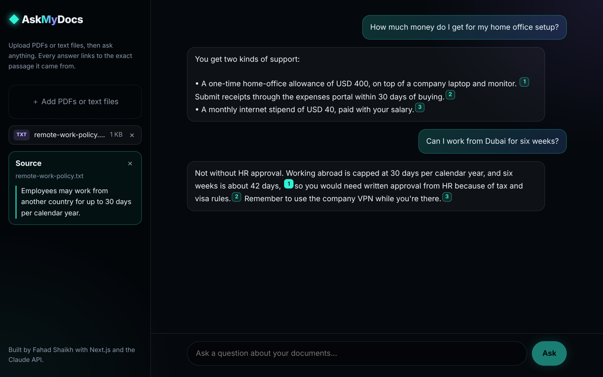

# AskMyDocs

**Chat with your PDFs and notes. Every answer is grounded in your files and comes with numbered citations. Click one to see the exact passage it came from.**



## Features

- **Upload PDFs, `.txt`, `.md` or `.csv`**, several at once
- **Streaming answers**: text appears as Claude writes it
- **Real citations**: uses Claude's built-in [citations](https://platform.claude.com/docs/en/build-with-claude/citations) feature, so every claim links to a quoted passage (with page numbers for PDFs). This is not a "please cite your sources" prompt; it's enforced by the API
- **Honest when it doesn't know**: the system prompt tells Claude to say so when the documents don't contain the answer
- **Multi-turn chat with prompt caching**: documents sit at a stable position at the start of the conversation and are cached, so follow-up questions are faster and much cheaper
- **No database, no vector store**: documents live in the browser tab, and nothing is stored on a server
- **Sample mode**: click *Try the sample document* to explore without an API key

## How it works

```
Browser                              /api/chat (Next.js)                   Claude API
 ├─ reads files (PDF → base64)  ──▶  builds document blocks             ──▶ messages.stream()
 │                                   citations: { enabled: true }           (citations + cache)
 │                                   cache_control on last document
 ◀── NDJSON stream ──────────────────  {"type":"delta"} … {"type":"final", parts + citations}
```

1. The client sends the documents and the chat history to `/api/chat`.
2. The route puts every document into the first user turn as a `document` block with citations enabled, and marks the last one with `cache_control` so the whole document prefix is cached.
3. It calls `client.messages.stream()`, forwards text deltas as NDJSON for a live typing effect, then sends the final message's text blocks with their `citations` arrays.
4. The UI swaps the streamed text for the cited version and numbers each unique quote.

### Why not RAG with embeddings?

For a handful of documents, sending them straight to a long-context model is simpler and more accurate than chunking and vector search. There are no retrieval misses, there's no infrastructure, and prompt caching keeps repeat questions cheap. Embeddings would be the next step for hundreds of documents (see *Next steps*).

## Tech stack

Next.js 16 (App Router) · React 19 · TypeScript · Anthropic TypeScript SDK (`claude-opus-5-5`) · Citations · Prompt caching · Streaming

## Run it locally

```bash
git clone https://github.com/FahadAsad10/askmydocs.git
cd askmydocs
npm install
cp .env.example .env.local   # then add your ANTHROPIC_API_KEY
npm run dev                  # http://localhost:3000
```

Deploy on Vercel by importing the repo and adding `ANTHROPIC_API_KEY`.

## Project structure

```
app/
  api/chat/route.ts   # document blocks, citations, caching, streaming
  page.tsx            # upload sidebar, chat thread, citation viewer
lib/
  types.ts            # shared types, including the NDJSON stream events
  sample.ts           # fictional sample document and conversation
```

## Next steps

- Highlight the cited passage inside a PDF viewer
- Save conversations locally
- Add embeddings-based retrieval for large document sets

## License

MIT, built by Fahad Shaikh with [Claude Code](https://claude.com/claude-code).
